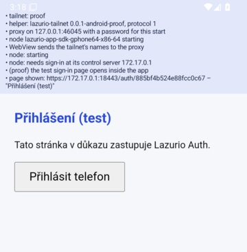
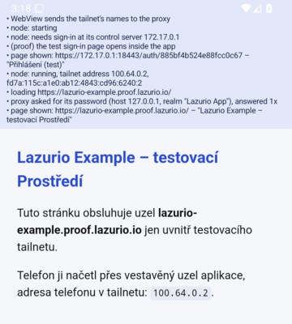

# Proof: the web Lazurio in an Android app with the built-in tailnet

A throwaway proof for the phone app's proposal ([docs/proposals/phone-app.md](../../docs/proposals/phone-app.md)). It is not Lazurio App and ships nowhere. It answers one question: can an Android app reach an Environment's page through Lazurio App's own tailnet helper, without Tailscale installed, a VPN or any special permission?

**Yes.** On an emulator with Android 16 (API 36, WebView 133), on 2026-11-26:

1. The app starts the desktop app's tailnet helper (`helpers/tailnet`) as a child process and speaks the helper protocol with it (`proto/lazurio/app`, size-delimited protobuf over standard input and output), exactly as the desktop app's main process does.
2. The helper reports `Hello` and its loopback proxy with a password made for this start. The app keeps the node's state key sealed by the Android Keystore, the phone's counterpart of [ADR 0003](../../docs/adr/0003-node-state-sealed.md).
3. The WebView sends only the tailnet's own names to the proxy (androidx.webkit `ProxyController` with a reverse bypass list), as the desktop app's PAC script does. Every other address goes directly.
4. **The WebView answers the proxy's password challenge itself** (`WebViewClient.onReceivedHttpAuthRequest` with host `127.0.0.1` and realm `Lazurio App`), so no page and no other app ever sees the password.
5. The node asks for a sign-in. The app shows the test control server's sign-in page; the person confirms; the node runs.
6. The WebView loads `https://lazurio-example.proof.lazurio.io/`, a page served by a node that exists only inside the test tailnet.

Checks against it:

- A process of another user (`adb shell`, uid 2000) that connects to the proxy without the password, or with a wrong one, gets `407 Proxy Authentication Required`.
- Outside the app, the Environment's name does not resolve (`ping: unknown host`).
- Against the real control server of Lazurio Example (the built-in directory of the desktop app), the node reached Headscale and got its sign-in address, which the app opened in the system's browser: Lazurio Auth sent it on to GitHub's sign-in "to continue to Lazurio Workspace". The proof stopped there; nobody signed in and no Device was approved.

 

## What the helper needed on Android

The helper's code is unchanged. The proof adds one file at build time with `go build -overlay` ([helper-overlay/androidbin_proof.go](helper-overlay/androidbin_proof.go)), for three things Android does differently:

| On Android                                                                         | In the proof                                                                                                               | In the real app                                                                                                                   |
| ---------------------------------------------------------------------------------- | -------------------------------------------------------------------------------------------------------------------------- | --------------------------------------------------------------------------------------------------------------------------------- |
| Apps may not read network interfaces over netlink, so `net.Interfaces` fails       | Tailscale's `feature/androidbin`, which builds one interface from a routed UDP socket; the helper is a static Linux binary | The app tells the helper its networks and each change of them, as Tailscale's Android app does (`netmon.RegisterInterfaceGetter`) |
| There is no `/etc/resolv.conf`                                                     | `androidbin` resolves through Android's DNS daemon; the control client's own resolver is pointed at it                     | A cgo build for Android, whose resolver goes through bionic                                                                       |
| A Linux build binds its dials to the default route's interface, found over netlink | Turned off (`netns.SetEnabled(false)`)                                                                                     | The Android build of tsnet does not bind                                                                                          |

## Run it

On the station, KVM belongs to the group `kvm`, so the emulator runs in a container that gets `/dev/kvm`.

1. `hostenv/`: `go build -o hostenv . && ./hostenv -out out` plays the test tailnet on the Docker bridge (172.17.0.1): a control server that asks every new node to sign in, a DERP relay with STUN, and the test Environment's node. It writes `out/ca.pem` and `out/tailnet.json`.
2. `./build-helper.sh hostenv/out` builds `helpers/tailnet` for `x86_64` and `arm64-v8a` into `app/src/main/jniLibs` and copies the test CA and tailnet entry.
3. `gradle assembleDebug` (Gradle 8.14.3, JDK 21, Android SDK 36). Only a debuggable build trusts the test CA (`network_security_config.xml`, `debug-overrides`).
4. `adb install app/build/outputs/apk/debug/app-debug.apk`, then `adb shell am start -n io.lazurio.app.proof/.MainActivity --es tailnet proof` for the test tailnet, or `--es tailnet example` for Lazurio Example.

The proof is not in the repository's checks: it is Java, Gradle and a second Go module, none of which ADR 0001 admits. Whether the real phone app lives here, and in which languages, is the proposal's question.
