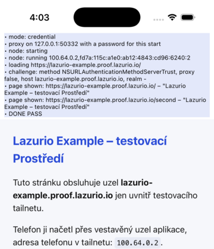

# Proof: the web Lazurio in an iOS app with the built-in tailnet

A throwaway proof for the phone app's proposal ([docs/proposals/phone-app.md](../../docs/proposals/phone-app.md)), the iOS counterpart of the [Android proof](../android-tailnet-webview/README.md). It is not Lazurio App and ships nowhere. It runs in CI on a macOS runner (`.github/workflows/phone-proof-ios.yml`), on the iOS simulator, which runs an app signed ad hoc, so it needs no Apple account.

**It works on the simulator.** Run of 2026-11-26 on the iOS 26 simulator (iPhone 17 Pro):

1. The test tailnet of the Android proof (`../android-tailnet-webview/hostenv`) runs on the runner's loopback, here without the node's sign-in (`-no-auth`), since the Android proof showed the sign-in.
2. iOS lets an app start no child process, so `helpers/tailnet` is linked into the Swift app as a C archive. One file added at build time ([helper-overlay/ios_export.go](helper-overlay/ios_export.go)) replaces the helper's standard input and output with two functions that call the helper's own nodes and proxy. The helper's code is unchanged.
3. The node runs; the app sets the data store's proxy (`WKWebsiteDataStore.proxyConfigurations`, iOS 17) to the helper's loopback proxy for the tailnet's names only (`matchDomains`), with the proxy's password (`ProxyConfiguration.applyCredential`).
4. `WKWebView` loads the test Environment's page and then a second page in the same view. Both go through the proxy: the test Environment's log shows both served to the phone's tailnet address.

| Mode         | What the app gives                                         | Result                                                                                                                                                                                         |
| ------------ | ---------------------------------------------------------- | ---------------------------------------------------------------------------------------------------------------------------------------------------------------------------------------------- |
| `credential` | the password in the proxy's configuration                  | **pass**: both pages loaded through the proxy                                                                                                                                                  |
| `challenge`  | no password in the configuration; answers only a challenge | WebKit asked for the proxy's credentials (`HTTPBasic`, `isProxy`, host `127.0.0.1`, no realm). The proof answers only with the realm `Lazurio App`, so it did not, and the page failed to load |

The second mode shows that without the password the page does not load, so WebKit does not bypass the proxy, and that the app could also answer WebKit's challenge itself.

Not verified: a real iPhone, which needs the Apple Developer membership; iOS 17 and 18, which the runner also has as simulators.

## Run it

`run-in-ci.sh` does everything on a Mac with Xcode and Go: the test tailnet, the C archive for the simulator, the Swift app built with `swiftc` and signed ad hoc, a booted iPhone simulator with the test CA in its keychain, and the app in both modes. Results, screenshots and the test tailnet's log land in `out/`; CI uploads them as the artifact `ios-proof`.
